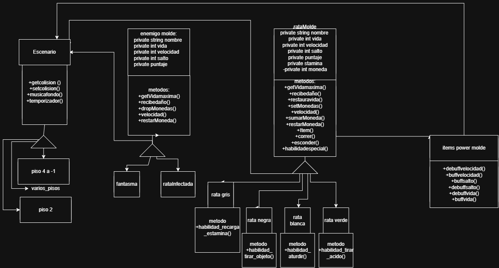

# Nombre del juego : Ghost and Ratas - The Queso CONQUEST!!!
## 1. Integrantes del Equipo 
 
- [Santana Lautaro Agustín](https://github.com/lautarosantana0912)

- [Leal Montenegro Ivo Ezequiel](https://github.com/ivoleal-cmd)

- [Huichaquelen Enzo Joaquín](https://github.com/Enzo-TRS71)

- [Escobar Nazareno Jesus](https://github.com/Naza1921)
  
## 2. Dominio y Alcance del Sistema 

### Descripción del Problema
Se busca desarrollar un video juego del genero de "plataformas" donde Eres una rata que se encuentra en el piso 4 de un edificio y tenés que llegar al piso -2 donde está la cocina, donde se encuentra el queso que queremos comer.

### Objetivo del Sistema
El sistema será un juego funcional y extensible que permitirá al jugador experimentar las mecánicas básicas del género. El diseño debe ser modular para facilitar la adición de nuevos tipos de ratas, enemigos o mapas en el futuro, aplicando rigurosamente los conceptos del paradigma orientado a objetos.

## Funcionalidades Principales (Features)
Desplazamiento: Las/las ratas se desplazan entre los pisos, esquivando las amenazas de nivel, como distintos fantasmas o baldes de agua con lavandina tirados, porque si las ratas hacen contacto con estos reciben daño.

Comida: Por los niveles hay comida tirada en buen y mal estado, que pueden darle power ups o power downs temporales a las ratitas.

Game Over: Puede ocurrir de 2 maneras posibles:Perdiste vida por un fantasma y ellos te llevaron para tenerte de mascota.
Se hicieron las 6 am y llegaron los encargados de limpiar el edificio con vos incluido.

Fin del juego: Una vez tengamos el queso terminamos el juego y se nos muestra nuestro tiempo de juego y nuestro puntaje, que se calcula según: tiempo que se tardó en terminar el juego, puntaje por comer comida o se nos resta por comer comida en mal estado o haber recibido daño en el nivel.

#### Mecánicas de Juego

Movimiento y Controles
Movimiento básico: izquierda / derecha, salto.
Acciones especiales: agacharse, interactuar (comer).
Configuración de controles (teclado).
Pausa: presionar ESC abre un menú desde el que se puede reanudar la partida o volver al menú principal.

Sistema de Daño y Vida
Puntos de vida (HP) y visualización (corazones, iconos de queso, etc.).
Fuentes de daño: fantasmas, baldes de lavandina, trampas eléctricas, pinchos, etc.

Efecto de daño: reducción de HP, posible aturdimiento o retroceso.

#### Objetos Interactables
Comida buena: otorga power‑ups temporales (velocidad, salto alto, invulnerabilidad, etc.).
Comida mala: provoca power‑downs (lentos, visión borrosa, controles invertidos, pérdida de HP).
Otros objetos: plataformas móviles , trampas activables.

#### Enemigos y Obstáculos por Nivel

Fantasmas: patrullas estáticas o rutas predefinidas; 
contacto = daño.
Trampas de piso: pinchos, láminas eléctricas, superficies resbaladizas.

#### Sistema de Power‑Ups / Power‑Downs
Duración: temporizador visible (icono + cuenta regresiva).
Ejemplos de efectos:
Velocidad++, salto triple, invisibilidad (comida buena).
Lentos, controles invertidos (comida mala).
Condiciones de Game Over

Daño por fantasma → Secuestro: la rata es capturada y se muestra una escena de “mascota”.
Comer comida en mal estado → Intoxicación: animación de enfermedad y pérdida de vida.
Llegar las 6 am: los encargados de limpieza aparecen y atrapan a la rata (incluida en la limpieza).
Pantalla de Game Over: mensaje correspondiente, opción de reiniciar o volver al menú.

#### Sistema de Puntos y Tiempo
Tiempo de juego: cronómetro que comienza al iniciar y se detiene al terminar.
El HUD ya muestra el tiempo transcurrido en formato `MM:SS` con el sprite `src/assets/temporizador.png`.
La cámara de presentación sigue suavemente al personaje con zoom 2× y límites
del mapa; el HUD permanece fijo en la pantalla mientras el escenario se desplaza.
Puntos por comida buena: +X puntos por cada pieza consumida.
Penalización por comida mala: –Y puntos por cada pieza consumida.
Penalización por daño recibido: –Z puntos por cada punto de vida perdido (o por cada contacto con enemigo/trampa).

Puntuación final:
Score = (Puntos comida buena) – (Puntos comida mala) – (Penalizaciones daño) – (Factor tiempo opcional)
Visualización: tiempo y puntuación mostrados al final y opcionalmente durante la partida (HUD).Estructura de Niveles Pisos
Piso	Descripción	Enemigos Principales	Obstáculos	Comida Disponible

## Estructura de Niveles Pisos
| Piso | Descripción | Enemigos Principales | Obstáculos | Comida Disponible |
|------|-------------|----------------------|------------|-------------------|
| 4    | Piso de partida (apartamento) | Fantasmas de baja intensidad | Cajas, alfombras | Migas, queso rallado |
| 3    | Pasillo de servicio | Fantasmas patrullando | Tubos con fugas | Restos de pizza, fruta |
| 2    | Área de lavandería | Baldes de lavandina | Máquinas de lavar en movimiento | Detergente (mala), sobras |
| 1    | Lobby / Recepción | Fantasmas + trampas de suelo | Puertas giratorias, alfombras móviles | Golosinas, sándwiches |
| 0    | Planta baja / Garage | Fantasmas + peligros de aceite | Coches estacionados, neumáticos | Aceite (mala), hot‑dogs |
| -1   | Bodega | Fantasmas + ratas enemigas | Estanterías inestables | Conservas (buenas/malas) | Queso (objetivo final) |

####  Arte y Estilo Visual
Paleta de colores: tonos oscuros y sucios con acentos amarillos/verdes para power‑ups y rojos para peligros.
Sprite del protagonista: ciclo de animación (idle, walk, jump, hurt, eat, power‑up).
Entorno: tilesets para paredes, pisos, techos, objetos interactivos.
Efectos: partículas de polvo, chispas de lavandina, brillos al obtener power‑up, pantalla temblor al daño.
UI: barra de vida, contador de tiempo, íconos de activos power‑up, mini‑mapa opcional.

#### Audio y Musica
Música de fondo: Un tema en bucle que queda a lección del jugador desde menu de  ajustes
Efectos de sonido: salto, golpe, comer (bueno/malo), daño, aparición de fantasma, activación de trampa, jingle de game over, fanfara de victoria.
Voces/Opcionales: gruñidos de rata, risas fantasmas, anunciador de “¡6 am!”.

#### Panel de ajustes
El menu principal incluye una pantalla de opciones con controles para activar la
musica, elegir entre las dos canciones incluidas, ajustar el volumen, cambiar el
tema de la pantalla de ajustes y alternar pantalla completa. Las preferencias
pueden guardarse o restaurarse a sus valores estandar; la musica se reproduce
en bucle mediante JavaFX Media. Los audios estan en `src/assets/audio/`.

### Plan de Desarrollo
Roadmap sugerido por fases

#### Pre‑producción
Documento de diseño (este README).
Prototipo de mecánicas básicas (movimiento, salto, colisión).
Definición de arte .
#### Producción
Implementación de sistemas de vida, daño y enemigos.
Creación de niveles/pisos con sus amenazas y objetos.
Desarrollo de power‑ups/power‑downs.Programación del jefe final y su lógica.
Integración de HUD, cronómetro y puntuación.Implementación de pantalla de inicio, pausa y game over.
#### Post‑producción
Pulido de arte y animaciones.
Balanceo de dificultad (tiempo, frecuencia de enemigos).
Pruebas de juego y ajuste de controles.
Integración de audio y música.
Build y pruebas en plataformas objetivo.

#### Este README es solo un punto de partida. A medida que el proyecto avance, se pueden agregar, modificar o eliminar secciones según las necesidades específicas del juego.

//Esta la portada de el juego


//Este es el Diagrama de la idea del juego (No es propiamente un DER)

//Usamos Draw.io para hacer el diagrama

## Patrones de diseño aplicados


En el juego utilizamos varios tipos de `Patrones de Diseño` 

###  simple Factory: `Creación de personaje `
 El problema que se nos presento cuando nos toco trabajar en el código fue ver que en varias parte del código como por ejemplo ; `PanelDeSeleccion`  y `ProncipalControlador` se encontraba el código para instanciar a la rata seleccionada por esta razón decidimos que era mejor  aplicar el patrón Factory que permite centralizar la creación de objetos tipo personaje ( cada rata ) pero llegamos a una concusión diferente cuando nos planteamos que capaz no era necesario la aplicación de este patrón ya que no teníamos pensado ampliar la cantidad de ratas. Pero si necesitábamos centralizarla llegamos a la solución de aplicar un simple Factory.

**En realidad no es un Patron de Diseño es mas una buena práctica.**

`PersonajeFactory` centraliza la creación de las distintas subclases de `Personaje`. Recibe un nombre y un valor de `Personaje.TipoRata`, y devuelve la instancia concreta correspondiente:

```public class PersonajeFactory {

    public static Personaje crearPersonaje(String nombre, Personaje.TipoRata tipoRata) {
        // Usamos un switch para determinar qué tipo de rata crear
        switch (tipoRata) {
            case GRIS -> {
                // Retorna una instancia de rata_gris
                return new rata_gris(nombre);
            }
            case BLANCA -> {
                // Retorna una instancia de rata_blanca
                return new rata_blanca(nombre);
            }
            case NEGRA -> {
                // Retorna una instancia de rata_negra
                return new rata_negra(nombre);
            }
            case VERDE -> {
                // Retorna una instancia de rata_verde
                return new rata_verde(nombre);
            }
            default -> // Si el tipo de rata no es válido, lanzamos una excepción
                throw new IllegalArgumentException("Tipo de rata no reconocido: " + tipoRata);
        }
    }
}
);
```
**Por qué es útil para el juego:**

- Mantiene en un único lugar la correspondencia entre tipo de rata y clase concreta.
- Evita repetir condicionales de creación en las vistas y controladores.
- Facilita añadir o ajustar tipos de rata sin propagar la lógica de construcción por todo el proyecto.

**IMPORTATNE:**
La aplicación   de este patron nos permite respetar los principios SOLID debido a que:
- Evitas un acoplamiento fuerte entre el creador y los productos concretos.
- Principio de responsabilidad única.Existe PersonajeFactory que es el unico responsable de instanciar el personje.
- No estariamos respetando Open/Close 


### Strategy: efectos temporales de power-ups

`EfectoTemporal` define el contrato de una estrategia: cada efecto declara su categoría y cómo aplicarse y revertirse sobre un `Personaje`. Las clases `EfectoVelocidad`, `EfectoLento` y `EfectoInvulnerabilidad` implementan ese contrato.

Cada objeto `PowerUp` contiene una estrategia y una duración en milisegundos. Por ejemplo, `PowerUpVelocidad` se construye con un `EfectoVelocidad`:

```java
PowerUp powerUp = new PowerUpVelocidad(
    5000, // duración en milisegundos
    120,  // posición X
    300   // posición Y
);
```

`GestorEfectosTemporales` activa la estrategia, guarda cuándo comenzó y la revierte cuando termina su duración. También puede comprobar una colisión con el personaje:

```java
boolean recogido = gestorEfectos.recogerSiColisiona(powerUp);
```

La partida mantiene el gestor y actualiza sus temporizadores durante el ciclo de juego. Los efectos de velocidad comparten categoría: si se activa `EfectoLento` mientras está activo `EfectoVelocidad`, el primero se revierte y el nuevo lo reemplaza. Si se vuelve a activar el mismo efecto, se renueva su duración. La invulnerabilidad pertenece a otra categoría, por lo que puede coexistir con cualquiera de los efectos de velocidad.

**Por qué es útil para el juego:**

- Cada efecto tiene su propia implementación y puede cambiarse sin añadir una cadena de condiciones a `Personaje` o al controlador de partida.
- Permite incorporar efectos nuevos implementando `EfectoTemporal`, por ejemplo salto triple o controles invertidos, cuando se implementen esas mecánicas.
- Centraliza la activación, renovación, reemplazo y vencimiento de los efectos temporales.

**Estado actual:** las estrategias de Velocidad++, Lento e Invulnerabilidad están conectadas a la partida. Los objetos aparecen uno por sección del primer piso y se recogen automáticamente al contacto. Velocidad dura 5 segundos, lento 5 segundos e invulnerabilidad 3 segundos. Se usan los sprites de `src/assets/powerUp/`, mostrados a 30×30 px. Velocidad y lento se reemplazan entre sí; invulnerabilidad puede coexistir con uno de ellos.

El diagrama UML de las clases y relaciones del patrón Strategy está en [Diagrama UML de Strategy para power-ups](docs/uml-strategy-powerups.svg).

### Persistencia SQLite: DAO y Singleton

La aplicación guarda el mejor resultado de cada jugador en `Score.db`, en la
tabla `score` (`Nombre`, `Puntuacion` y `Tiempo`). Al completar el
nivel se solicita el nombre del jugador; el tiempo se almacena en segundos.
Para un mismo nombre se conserva la puntuación más alta y, en caso de empate,
el menor tiempo. El jugador puede consultar los resultados ordenados a través
de `PuntajeDAO.listarMejoresPuntajes()`; todavía no hay una pantalla de ranking.
Al recoger Velocidad se suman 475 puntos, Invulnerabilidad suma 1000 y Lento
resta 300, sin permitir que el puntaje baje de cero. El HUD refleja estos cambios
durante la partida. Además, cada 30 segundos completos se descuentan 10 puntos
del puntaje presentado, con un mínimo de cero; ese mismo puntaje ajustado se
guarda al completar el nivel. Cada golpe efectivo del fantasma descuenta 125
puntos, también con un mínimo de cero.

`ConexionSQLite` aplica Singleton y mantiene la conexión compartida. `PuntajeDAO`
define las operaciones de persistencia y `SQLitePuntajeDAO` las implementa con
sentencias preparadas. `ServicioPuntajes` recibe el DAO y coordina la creación
del resultado y su guardado; el controlador conserva únicamente la interacción
visual (solicitud del nombre y notificación al jugador). La aplicación utiliza
la ubicación `Score.db` en el directorio de ejecución por defecto. Si no existe
la tabla `score`, se crea al abrir la base. Se puede
indicar otra ruta absoluta con la propiedad Java
`-Dghostsrats.db.path=C:\ruta\Score.db` o con la variable
de entorno `GHOSTSRATS_DB_PATH`. Si la base configurada no existe, la aplicación
notifica el error en lugar de crear silenciosamente otra base vacía.
