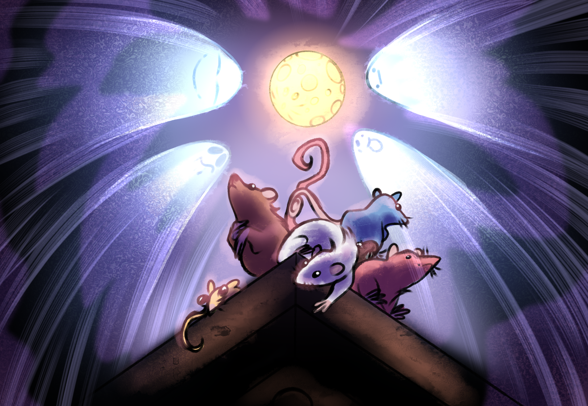
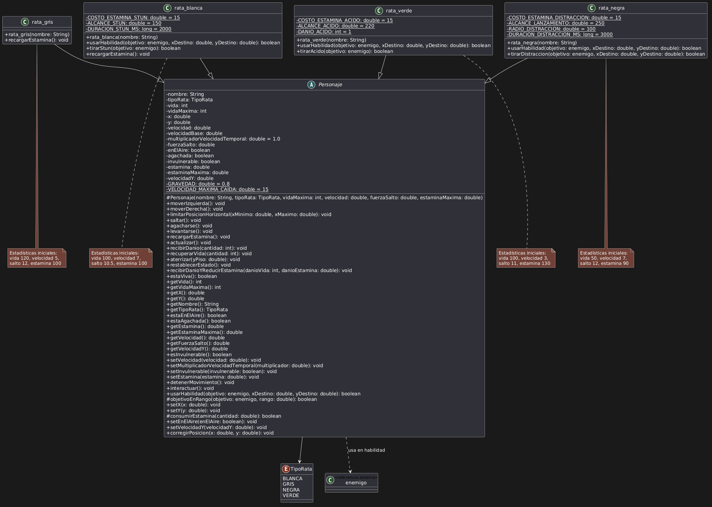
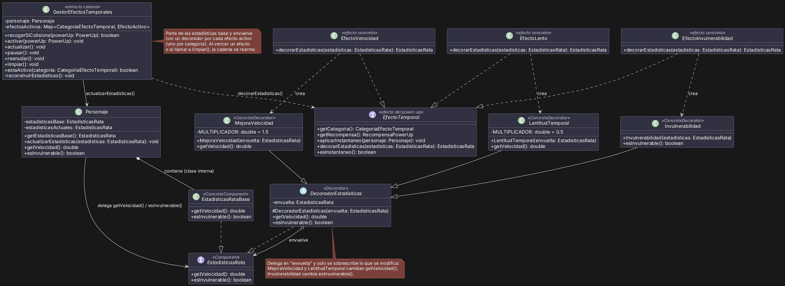

# Nombre del juego : Ghost and Ratas - The Queso CONQUEST!!!
## 1. Integrantes del Equipo 
 
- [Santana Lautaro Agustín](https://github.com/lautarosantana0912)

- [Leal Montenegro Ivo Ezequiel](https://github.com/ivoleal-cmd)

- [Huichaquelen Enzo Joaquín](https://github.com/Enzo-TRS71)

- [Escobar Nazareno Jesus](https://github.com/Naza1921)
  
## 2. Dominio y Alcance del Sistema 

### Descripción del Problema
Se busca desarrollar un video juego del genero de "plataformas" donde el jugador controla una rata busca atravesar varios niveles llenos de enemigos  hasta llegar a donde se encuentra el queso que queremos comer.

### Objetivo del Sistema
El sistema será un juego funcional y extensible que permitirá al jugador experimentar las mecánicas básicas del género. El diseño debe ser modular para facilitar la adición de nuevos tipo de power-ups, enemigos o mapas en el futuro, aplicando rigurosamente los conceptos del paradigma orientado a objetos.

## Funcionalidades Principales (Features)
Desplazamiento: Las/las ratas se desplazan entre los pisos, esquivando las amenazas de nivel, como distintos fantasmas o baldes de agua con lavandina tirados, porque si las ratas hacen contacto con estos reciben daño.

- Comida: Por los niveles hay comida tirada en buen y mal estado, que pueden darle power ups o power downs temporales a las ratitas.

- Game Over: Puede ocurrir de 2 maneras posibles:Perdiste vida por un fantasma y ellos te llevaron para tenerte de mascota.
Se hicieron las 6 am y llegaron los encargados de limpiar el edificio con vos incluido.

- Fin del juego: Una vez tengamos el queso terminamos el juego y se nos muestra nuestro tiempo de juego y nuestro puntaje, que se calcula según: tiempo que se tardó en terminar el juego, puntaje por comer comida o se nos resta por comer comida en mal estado o haber recibido daño en el nivel.

#### Mecánicas de Juego
  **teclas**
- Movimiento básico: izquierda / derecha, salto.
- Acciones especiales: interactuar (comer).
- Configuración de controles (teclado).
- Pausa: presionar ESC abre un menú desde el que se puede reanudar la partida o volver al menú principal.

**Sistema de Daño y Vida**
- Puntos de vida (HP) y visualización (corazones, iconos de queso, etc.).
- Fuentes de daño: fantasmas, baldes de lavandina, trampas eléctricas, pinchos, etc.
- Efecto de daño: reducción de HP, posible aturdimiento o retroceso.

#### Objetos Interactables
- Comida buena: otorga power‑ups temporales (velocidad, salto alto, invulnerabilidad, etc.).
- Comida mala: provoca power‑downs (lentos, visión borrosa, controles invertidos, pérdida de HP).
- Otros objetos:trampas activables.

#### Enemigos y Obstáculos por Nivel

- Fantasmas: patrullas estáticas o rutas predefinidas; contacto = daño.
- Trampas de piso: pinchos, láminas eléctricas, superficies resbaladizas.

#### Sistema de Power‑Ups / Power‑Downs
- Duración: temporizador visible (icono + cuenta regresiva).
- Ejemplos de efectos:
- Velocidad++, salto triple, invisibilidad (comida buena).
- Lentos, controles invertidos (comida mala).
- Curación 

Daño por fantasma → Secuestro: la rata es capturada y se muestra una escena de “mascota”.
Comer comida en mal estado → Intoxicación: animación de enfermedad y pérdida de vida.
Llegar las 6 am: los encargados de limpieza aparecen y atrapan a la rata (incluida en la limpieza).
Pantalla de Game Over: mensaje correspondiente, opción de reiniciar o volver al menú.

#### Sistema de Puntos y Tiempo
Tiempo de juego: cronómetro que comienza al iniciar y se detiene al terminar.
El HUD ya muestra el tiempo transcurrido en formato `MM:SS`.
La cámara de presentación sigue suavemente al personaje con zoom 2× y límites
del mapa; el HUD permanece fijo en la pantalla mientras el escenario se desplaza.
Puntos por comida buena: +X puntos por cada pieza consumida.
Penalización por comida mala: –Y puntos por cada pieza consumida.
Penalización por daño recibido: –Z puntos por cada punto de vida perdido (o por cada contacto con enemigo/trampa).

Puntuación final:
Score = (Puntos comida buena) – (Puntos comida mala) – (Penalizaciones daño) – (Factor tiempo opcional)
Visualización: tiempo y puntuación mostrados al final y opcionalmente durante la partida (HUD).Estructura de Niveles Pisos
Piso	Descripción	Enemigos Principales	Obstáculos	Comida Disponible

#### Audio y Musica
Música de fondo: Un tema en bucle que queda a lección del jugador desde menu de  ajustes
Efectos de sonido: salto, golpe, comer (bueno/malo), daño, aparición de fantasma, activación de trampa, jingle de game over, fanfara de victoria.
Voces/Opcionales: gruñidos de rata, risas fantasmas, anunciador de “¡6 am!”.

#### Panel de ajustes
El menu principal incluye una pantalla de opciones con controles para activar la
musica, elegir entre las dos canciones incluidas, ajustar el volumen, cambiar el
tema de la pantalla de ajustes y alternar pantalla completa. Las preferencias
pueden guardarse o restaurarse a sus valores estandar; la musica se reproduce
en bucle mediante JavaFX Media. Los audios estan en `src/assets/audio/`.


//Esta la portada de el juego





## Arquitectura y diseño 
 //Diagrama General del juego
 [Diagrama General del juego](docs/ghosts_and_rats_arquitectura_general.png)

//Este es el Diagrama de herencia de la clase personaje a cada rata  



### En el juego utilizamos varios tipos de `Patrones de Diseño` 

#### Factory Method: creación de personajes

`FabricaRata` es el creador abstracto y declara el método de fábrica `crearPersonaje()`. Cada creador concreto implementa ese método y devuelve una subclase de `Personaje`. `CatalogoFabricasRata` mantiene la lista inmutable de creadores disponibles, y el panel usa `crearRata()` para obtener el producto:

```java
package modelos.personajes;

public abstract class FabricaRata {
    protected abstract Personaje crearPersonaje();

    public final Personaje crearRata() {
        Personaje personaje = crearPersonaje();
        if (personaje == null) {
            throw new IllegalStateException("La fábrica no puede crear una rata nula");
        }
        String claveSprite = personaje.getClaveSprite();
        if (claveSprite == null || claveSprite.isBlank()) {
            throw new IllegalStateException("La rata creada debe tener una clave de sprite");
        }
        return personaje;
    }
}
```
**Por qué es útil para el juego:**

- Cada creador concreto decide qué subclase de `Personaje` crear sin usar un `switch`.
- El panel trabaja con la abstracción `FabricaRata` y no necesita conocer la clase concreta.
- Para agregar una rata nueva, se crea su clase de rata, una clase creadora, una línea en `CatalogoFabricasRata` y sus sprites en `CatalogoSpritesRatas`.


#### Decorator: efectos temporales sobre las estadísticas de la rata


`EstadisticasRata` es el componente: define `getVelocidad()` y `esInvulnerable()`. La clase interna `EstadisticasRataBase` de `Personaje` es el componente concreto y ofrece las estadísticas iniciales. `DecoradorEstadisticas` implementa la misma interfaz, guarda la instancia envuelta y delega en ella. `MejoraVelocidad`, `LentitudTemporal` e `Invulnerabilidad` son decoradores concretos que modifican una de esas respuestas.

`GestorEfectosTemporales.reconstruirEstadisticas()` parte de `Personaje.getEstadisticasBase()`, envuelve las estadísticas con un decorador por cada efecto activo y entrega el resultado a `Personaje.actualizarEstadisticas()`. Cada efecto (`EfectoVelocidad`, `EfectoLento` y `EfectoInvulnerabilidad`) crea su decorador mediante `decorarEstadisticas()`.

`EfectoTemporal` es el contrato del efecto del power-up: define su categoría, su recompensa y cómo aplicar efectos instantáneos o crear un decorador de estadísticas. El gestor mantiene como máximo un efecto activo por categoría; por eso, activar otro efecto de la misma categoría lo reemplaza.

```java
public abstract class DecoradorEstadisticas implements EstadisticasRata {
    private final EstadisticasRata envuelta;

    protected DecoradorEstadisticas(EstadisticasRata envuelta) {
        if (envuelta == null) {
            throw new IllegalArgumentException("Se requieren estadísticas para decorar");
        }
        this.envuelta = envuelta;
    }

    @Override
    public double getVelocidad() {
        return envuelta.getVelocidad();
    }
}
```

```java
public final class MejoraVelocidad extends DecoradorEstadisticas {
    private static final double MULTIPLICADOR = 1.5;

    public MejoraVelocidad(EstadisticasRata envuelta) {
        super(envuelta);
    }

    @Override
    public double getVelocidad() {
        return super.getVelocidad() * MULTIPLICADOR;
    }
}
```

**Por qué es útil para el juego:**

- Los cambios se agregan envolviendo estadísticas; `Personaje` consulta la abstracción `EstadisticasRata` sin agregar condicionales por cada efecto.
- Pueden coexistir efectos de distintas categorías, por ejemplo, uno de velocidad y uno de defensa. Los efectos de la misma categoría se reemplazan entre sí.
- Al vencer un efecto o limpiar los activos, el gestor reconstruye la cadena desde las estadísticas base, en lugar de deshacer cambios directamente sobre el personaje.

**Por qué es Decorator y no Strategy:** cada decorador envuelve un objeto con el mismo contrato y agrega comportamiento que puede combinarse con otras capas. En cambio, aquí el efecto asociado al power-up se fija cuando se crea (`PowerUpVelocidad` crea `EfectoVelocidad`, por ejemplo); el gestor recompone decoradores, no intercambia un algoritmo para una misma tarea.

[Patrón de diseño Decorator](https://refactoring.guru/es/design-patterns/decorator)

### Persistencia SQLite: DAO y Singleton
Persistencia de puntajes: Singleton y DAO

Para guardar y consultar los puntajes del juego se utilizan dos patrones de diseño: Singleton y DAO. En conjunto, permiten centralizar el acceso a la base de datos SQLite y mantener las consultas SQL separadas del resto de la aplicación.

Singleton: acceso compartido a la conexión
La clase ConexionSQLite administra la conexión con la base de datos. Su constructor es privado, por lo que no se pueden crear instancias desde otras clases. En cambio, se obtiene la instancia única mediante el método obtenerInstancia():

```java
private static ConexionSQLite unica;

private ConexionSQLite() { }

public static synchronized ConexionSQLite obtenerInstancia() {
    if (unica == null) {
        unica = new ConexionSQLite();
    }
    return unica;
}
```
Este mecanismo de inicialización diferida crea la instancia en la primera llamada a obtenerInstancia(). El método está sincronizado para evitar que dos hilos creen instancias distintas al mismo tiempo. Así, las distintas partes de la aplicación acceden al mismo gestor de conexión. El método obtenerConexion() abre la conexión cuando es necesario y la reutiliza mientras permanezca disponible. También prepara la tabla score si todavía no existe.

DAO: operaciones de persistencia encapsuladas
El patrón DAO (Data Access Object) se utiliza para aislar las operaciones de base de datos. La interfaz PuntajeDAO declara las acciones que se pueden realizar con los puntajes, sin incluir detalles específicos de SQLite:
```java
public interface PuntajeDAO {
    boolean guardarMejorPuntaje(ResultadoPuntaje resultado) throws SQLException;

    List<ResultadoPuntaje> listarMejoresPuntajes() throws SQLException;
}
```

La clase SQLitePuntajeDAO implementa esa interfaz y contiene las consultas SQL. Por ejemplo, para guardar un puntaje obtiene la conexión y utiliza un PreparedStatement:

```java
Connection conexion = conexionSQLite.obtenerConexion();
try (PreparedStatement sentencia =
         conexion.prepareStatement(INSERTAR_PUNTAJE)) {
    sentencia.setString(1, resultado.getNombre());
    sentencia.setInt(2, resultado.getPuntuacion());
    sentencia.setLong(3, resultado.getTiempoSegundos());
    return sentencia.executeUpdate() > 0;
}
```
La consulta guarda el mejor resultado de cada jugador: reemplaza el anterior si la nueva puntuación es más alta o, en caso de empate, si se obtuvo en menos tiempo. La otra operación recupera los puntajes ordenados para mostrarlos en el tablero.


## Tecnologías 
```
- Lenguaje: Java.
- IDE: Visual Studio Code.
- Framework de IGU: Java Swing y AWT.
- Control de Versiones: Git y GitHub.
- Base de datos: SQLite
- Framework de gestor de musica :JavaFX
```
