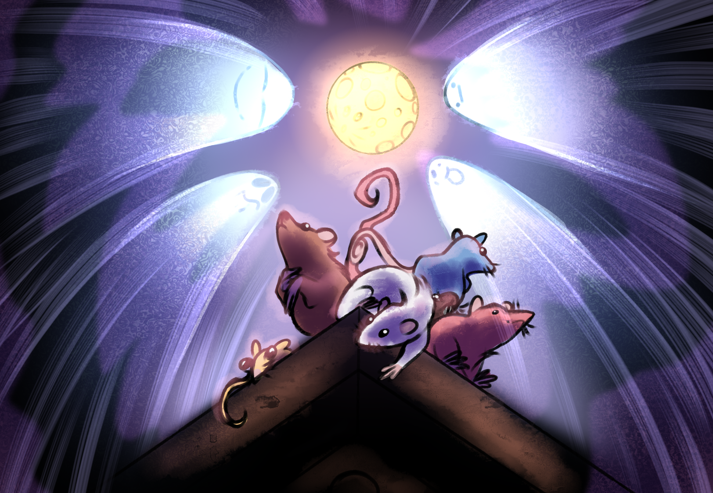
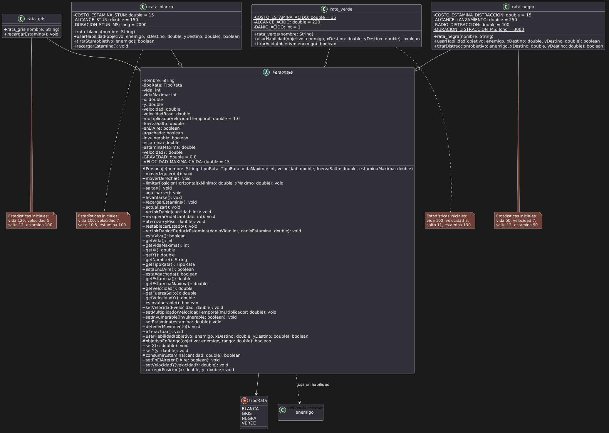
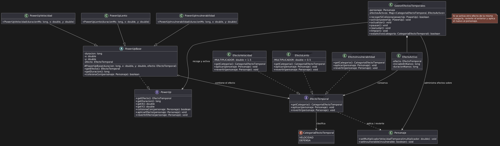

# Nombre del juego : Ghost and Ratas - The Queso CONQUEST!!!
## 1. Integrantes del Equipo 
 
- [Santana Lautaro Agustín](https://github.com/lautarosantana0912)

- [Leal Montenegro Ivo Ezequiel](https://github.com/ivoleal-cmd)

- [Huichaquelen Enzo Joaquín](https://github.com/Enzo-TRS71)

- [Escobar Nazareno Jesus](https://github.com/Naza1921)
  
## 2. Dominio y Alcance del Sistema 

### Descripción del Problema
Se busca desarrollar un video juego del genero de "plataformas" donde el jugador controla una rata busca atravesar varios niveles llenos de enemigos  hasta llegar a donde se encuentra el queso que queremos comer.

### Objetivo del Sistema
El sistema será un juego funcional y extensible que permitirá al jugador experimentar las mecánicas básicas del género. El diseño debe ser modular para facilitar la adición de nuevos tipo de power-ups, enemigos o mapas en el futuro, aplicando rigurosamente los conceptos del paradigma orientado a objetos.

## Funcionalidades Principales (Features)
Desplazamiento: Las/las ratas se desplazan entre los pisos, esquivando las amenazas de nivel, como distintos fantasmas o baldes de agua con lavandina tirados, porque si las ratas hacen contacto con estos reciben daño.

- Comida: Por los niveles hay comida tirada en buen y mal estado, que pueden darle power ups o power downs temporales a las ratitas.

- Game Over: Puede ocurrir de 2 maneras posibles:Perdiste vida por un fantasma y ellos te llevaron para tenerte de mascota.
Se hicieron las 6 am y llegaron los encargados de limpiar el edificio con vos incluido.

- Fin del juego: Una vez tengamos el queso terminamos el juego y se nos muestra nuestro tiempo de juego y nuestro puntaje, que se calcula según: tiempo que se tardó en terminar el juego, puntaje por comer comida o se nos resta por comer comida en mal estado o haber recibido daño en el nivel.

#### Mecánicas de Juego
  **teclas**
- Movimiento básico: izquierda / derecha, salto.
- Acciones especiales: interactuar (comer).
- Configuración de controles (teclado).
- Pausa: presionar ESC abre un menú desde el que se puede reanudar la partida o volver al menú principal.

**Sistema de Daño y Vida**
- Puntos de vida (HP) y visualización (corazones, iconos de queso, etc.).
- Fuentes de daño: fantasmas, baldes de lavandina, trampas eléctricas, pinchos, etc.
- Efecto de daño: reducción de HP, posible aturdimiento o retroceso.

#### Objetos Interactables
- Comida buena: otorga power‑ups temporales (velocidad, salto alto, invulnerabilidad, etc.).
- Comida mala: provoca power‑downs (lentos, visión borrosa, controles invertidos, pérdida de HP).
- Otros objetos:trampas activables.

#### Enemigos y Obstáculos por Nivel

- Fantasmas: patrullas estáticas o rutas predefinidas; contacto = daño.
- Trampas de piso: pinchos, láminas eléctricas, superficies resbaladizas.

#### Sistema de Power‑Ups / Power‑Downs
- Duración: temporizador visible (icono + cuenta regresiva).
- Ejemplos de efectos:
- Velocidad++, salto triple, invisibilidad (comida buena).
- Lentos, controles invertidos (comida mala).
- Curación 

Daño por fantasma → Secuestro: la rata es capturada y se muestra una escena de “mascota”.
Comer comida en mal estado → Intoxicación: animación de enfermedad y pérdida de vida.
Llegar las 6 am: los encargados de limpieza aparecen y atrapan a la rata (incluida en la limpieza).
Pantalla de Game Over: mensaje correspondiente, opción de reiniciar o volver al menú.

#### Sistema de Puntos y Tiempo
Tiempo de juego: cronómetro que comienza al iniciar y se detiene al terminar.
El HUD ya muestra el tiempo transcurrido en formato `MM:SS`.
La cámara de presentación sigue suavemente al personaje con zoom 2× y límites
del mapa; el HUD permanece fijo en la pantalla mientras el escenario se desplaza.
Puntos por comida buena: +X puntos por cada pieza consumida.
Penalización por comida mala: –Y puntos por cada pieza consumida.
Penalización por daño recibido: –Z puntos por cada punto de vida perdido (o por cada contacto con enemigo/trampa).

Puntuación final:
Score = (Puntos comida buena) – (Puntos comida mala) – (Penalizaciones daño) – (Factor tiempo opcional)
Visualización: tiempo y puntuación mostrados al final y opcionalmente durante la partida (HUD).Estructura de Niveles Pisos
Piso	Descripción	Enemigos Principales	Obstáculos	Comida Disponible

#### Audio y Musica
Música de fondo: Un tema en bucle que queda a lección del jugador desde menu de  ajustes
Efectos de sonido: salto, golpe, comer (bueno/malo), daño, aparición de fantasma, activación de trampa, jingle de game over, fanfara de victoria.
Voces/Opcionales: gruñidos de rata, risas fantasmas, anunciador de “¡6 am!”.

#### Panel de ajustes
El menu principal incluye una pantalla de opciones con controles para activar la
musica, elegir entre las dos canciones incluidas, ajustar el volumen, cambiar el
tema de la pantalla de ajustes y alternar pantalla completa. Las preferencias
pueden guardarse o restaurarse a sus valores estandar; la musica se reproduce
en bucle mediante JavaFX Media. Los audios estan en `src/assets/audio/`.


//Esta la portada de el juego



## Arquitectura y diseño 

//Este es el Diagrama de herencia de la clase personaje a cada rata  



### En el juego utilizamos varios tipos de `Patrones de Diseño` 

####  simple Factory: `Creación de personaje `
 El problema que se nos presento cuando nos toco trabajar en el código fue ver que en varias parte del código como por ejemplo ; `PanelDeSeleccion`  y `ProncipalControlador` se encontraba el código para instanciar a la rata seleccionada por esta razón decidimos que era mejor  aplicar el patrón Factory que permite centralizar la creación de objetos tipo personaje ( cada rata ) pero llegamos a una concusión diferente cuando nos planteamos que capaz no era necesario la aplicación de este patrón ya que no teníamos pensado ampliar la cantidad de ratas. Pero si necesitábamos centralizarla llegamos a la solución de aplicar un simple Factory.

**En realidad no es un Patron de Diseño es mas una buena práctica.**

`PersonajeFactory` centraliza la creación de las distintas subclases de `Personaje`. Recibe un nombre y un valor de `Personaje.TipoRata`, y devuelve la instancia concreta correspondiente:

```java
public class PersonajeFactory {

    public static Personaje crearPersonaje(String nombre, Personaje.TipoRata tipoRata) {
        // Usamos un switch para determinar qué tipo de rata crear
        switch (tipoRata) {
            case GRIS -> {
                // Retorna una instancia de rata_gris
                return new rata_gris(nombre);
            }
            case BLANCA -> {
                // Retorna una instancia de rata_blanca
                return new rata_blanca(nombre);
            }
            case NEGRA -> {
                // Retorna una instancia de rata_negra
                return new rata_negra(nombre);
            }
            case VERDE -> {
                // Retorna una instancia de rata_verde
                return new rata_verde(nombre);
            }
            default -> // Si el tipo de rata no es válido, lanzamos una excepción
                throw new IllegalArgumentException("Tipo de rata no reconocido: " + tipoRata);
        }
    }
}
;
```
**Por qué es útil para el juego:**

- Mantiene en un único lugar la correspondencia entre tipo de rata y clase concreta.
- Evita repetir condicionales de creación en las vistas y controladores.
- Facilita añadir o ajustar tipos de rata sin propagar la lógica de construcción por todo el proyecto.


#### Strategy: efectos temporales de power-ups


`EfectoTemporal` define el contrato de una estrategia: cada efecto declara su categoría y cómo aplicarse y revertirse sobre un `Personaje`. Las clases `EfectoVelocidad`, `EfectoLento` y `EfectoInvulnerabilidad` implementan ese contrato.
```java
public interface EfectoTemporal {
    CategoriaEfectoTemporal getCategoria();
    void aplicar(Personaje personaje);
    void revertir(Personaje personaje);
}
```
Cada objeto `PowerUp` contiene una estrategia y una duración en milisegundos. Por ejemplo, `PowerUpVelocidad` se construye con un `EfectoVelocidad`:


```java
public final class EfectoVelocidad implements EfectoTemporal {
    private static final double MULTIPLICADOR = 1.5;

    @Override
    public CategoriaEfectoTemporal getCategoria() {
        return CategoriaEfectoTemporal.VELOCIDAD;
    }

    @Override
    public void aplicar(Personaje personaje) {
        personaje.setMultiplicadorVelocidadTemporal(MULTIPLICADOR);
    }

    @Override
    public void revertir(Personaje personaje) {
        personaje.setMultiplicadorVelocidadTemporal(1.0);
    }
}
```

`GestorEfectosTemporales` activa la estrategia, guarda cuándo comenzó y la revierte cuando termina su duración:
La partida mantiene el gestor y actualiza sus temporizadores durante el ciclo de juego. Los efectos de velocidad comparten categoría: si se activa `EfectoLento` mientras está activo `EfectoVelocidad`, el primero se revierte y el nuevo lo reemplaza. Si se vuelve a activar el mismo efecto, se renueva su duración. La invulnerabilidad pertenece a otra categoría, por lo que puede coexistir con cualquiera de los efectos de velocidad.

```java
public void activar(PowerUp powerUp) {
    if (powerUp == null || powerUp.getEfecto() == null || powerUp.getDuracion() <= 0) {
        throw new IllegalArgumentException("El power-up debe tener efecto y duración válidos");
    }
    EfectoTemporal nuevoEfecto = powerUp.getEfecto();
    CategoriaEfectoTemporal categoria = nuevoEfecto.getCategoria();

    long ahora = System.nanoTime();
    long duracionNanos = TimeUnit.MILLISECONDS.toNanos(powerUp.getDuracion());
    EfectoActivo anterior = efectosActivos.get(categoria);

    if (anterior != null && anterior.efecto.getClass() != nuevoEfecto.getClass()) {
        anterior.efecto.revertir(personaje);
        efectosActivos.remove(categoria);
        anterior = null;
    }
    if (anterior == null) {
        nuevoEfecto.aplicar(personaje);
    }
    efectosActivos.put(categoria, new EfectoActivo(nuevoEfecto, ahora, duracionNanos));
}
```
**Por qué es útil para el juego:**

- Cada efecto tiene su propia implementación y puede cambiarse sin añadir una cadena de condiciones a `Personaje` o al controlador de partida.
- Permite incorporar efectos nuevos implementando `EfectoTemporal`, por ejemplo salto triple o controles invertidos, cuando se implementen esas mecánicas.
- Centraliza la activación, renovación, reemplazo y vencimiento de los efectos temporales.


[Patrones de diseño STRATEGY](https://refactoring.guru/es/design-patterns/strategy)

### Persistencia SQLite: DAO y Singleton
Persistencia de puntajes: Singleton y DAO

Para guardar y consultar los puntajes del juego se utilizan dos patrones de diseño: Singleton y DAO. En conjunto, permiten centralizar el acceso a la base de datos SQLite y mantener las consultas SQL separadas del resto de la aplicación.

Singleton: acceso compartido a la conexión
La clase ConexionSQLite administra la conexión con la base de datos. Su constructor es privado, por lo que no se pueden crear instancias desde otras clases. En cambio, se obtiene la instancia única mediante el método obtenerInstancia():

```java
private ConexionSQLite() { }

private static class Instancia {
    private static final ConexionSQLite UNICA = new ConexionSQLite();
}

public static ConexionSQLite obtenerInstancia() {
    return Instancia.UNICA;
}
```
Este mecanismo crea la instancia cuando se solicita por primera vez y asegura que las distintas partes de la aplicación accedan al mismo gestor de conexión. El método obtenerConexion() abre la conexión cuando es necesario y la reutiliza mientras permanezca disponible. También prepara la tabla score si todavía no existe.

DAO: operaciones de persistencia encapsuladas
El patrón DAO (Data Access Object) se utiliza para aislar las operaciones de base de datos. La interfaz PuntajeDAO declara las acciones que se pueden realizar con los puntajes, sin incluir detalles específicos de SQLite:
```java
public interface PuntajeDAO {
    boolean guardarMejorPuntaje(ResultadoPuntaje resultado) throws SQLException;

    List<ResultadoPuntaje> listarMejoresPuntajes() throws SQLException;
}
```

La clase SQLitePuntajeDAO implementa esa interfaz y contiene las consultas SQL. Por ejemplo, para guardar un puntaje obtiene la conexión y utiliza un PreparedStatement:

```java
Connection conexion = conexionSQLite.obtenerConexion();
try (PreparedStatement sentencia =
         conexion.prepareStatement(INSERTAR_PUNTAJE)) {
    sentencia.setString(1, resultado.getNombre());
    sentencia.setInt(2, resultado.getPuntuacion());
    sentencia.setLong(3, resultado.getTiempoSegundos());
    return sentencia.executeUpdate() > 0;
}
```
La consulta guarda el mejor resultado de cada jugador: reemplaza el anterior si la nueva puntuación es más alta o, en caso de empate, si se obtuvo en menos tiempo. La otra operación recupera los puntajes ordenados para mostrarlos en el tablero.


## Tecnologías 
```
- Lenguaje: Java.
- IDE: Visual Studio Code.
- Framework de IGU: Java Swing y AWT.
- Control de Versiones: Git y GitHub.
- Base de datos: SQLite
- Framework de gestor de musica :JavaFX
```
